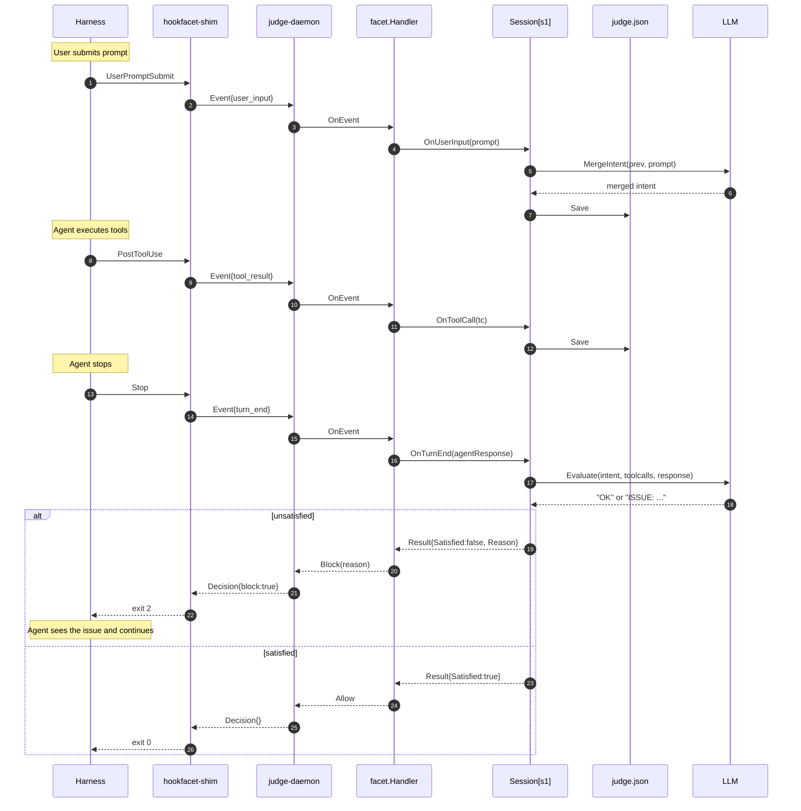

[](https://github.com/ironsweet/judge/actions/workflows/ci.yml)
[](https://pkg.go.dev/github.com/ironsweet/judge)

# judge

A Go module that judges whether an AI agent actually fulfilled what the user asked for -- and blocks the turn if it didn't.

## Why

Agents say "done" all the time. They claim they built this feature, ran the tests, checked git status -- but the tool
calls tell a different story. A single-turn LLM judge can catch this, but it needs to see the whole turn: the original
intent, every tool call, and the final response.

`judge` collects that state across three hook events, persists it to disk (so a daemon restart doesn't lose the picture),
and asks an LLM whether the agent's actions match the user's _intent_. If not, it returns a `Block` with a specific 
correction, and the harness triggers another round.

Works with any harness that exposes command hooks (Claude Code, Cursor, Codex) via
[hookfacet](https://github.com/ironsweet/hookfacet), or directly inside a Go agent.

> Why not `/goal`, prompt hooks, or script hooks?
> 
> `/goal` is a session-scoped Stop hook wrapper built into Claude Code -- it judges what the model _claimed_ in the
> transcript, and it doesn't exist outside that harness. Prompt hooks are stateless single-turn evaluations; they can't 
> see the tool calls that accumulated across the turn. Script hooks can do anything, but only inside the harness they 
> were written for -- a Claude Code Stop hook doesn't run on Cursor without being rewritten.
> 
> judge exists because the evaluation logic itself should be portable. It's a Go module, not a hook configuration: the 
> same `Judge` and `Session` code runs behind Claude Code via `hookfacet`, inside a Cursor shim, or directly in your own
> Go agent. You write the judgment once; the harness is an adapter, not a dependency.

## How it works



The key takeaway is `judge.json` -- it survives daemon restarts, so a session that spans multiple processes still has 
its full intent and tool call history. `OnTurnEnd` is the only event with `ModeDecide`; the other two are `ModeInspect` 
(record only, never block).

## Quick Start

### 1. Start the daemon

```shell
export JUDGE_LLM_API_KEY=sk-ant...
export JUDGE_LLM_MODEL=claude-haiku-4-5-20251001

go run ./cmd/judge-daemon
```

The daemon listens on `/tmp/judge.sock` by default. Override with `JUDGE_SOCKET`. Session state is written to 
`~/.judge/<session_id>/judge.json`; override the root with `JUDGE_WORKSPACE`.

### 2. Wire up Claude Code

```shell
go install github.com/ironsweet/hookfacet/cmd/hookfacet-shim@latest
```

```json
{
  "env": {
    "HOOKFACET_SOCKET": "/tmp/judge.sock",
    "HOOKFACET_HARNESS": "claude-code"
  },
  "hooks": {
    "UserPromptSubmit": [{ "hooks": [{ "type": "command", "command": "hookfacet-shim" }] }],
    "PostToolUse":      [{ "hooks": [{ "type": "command", "command": "hookfacet-shim" }] }],
    "Stop":             [{ "hooks": [{ "type": "command", "command": "hookfacet-shim" }] }]
  }
}
```

### 3. Try it

Ask Claude Code to do something that requires verification, like _"initialize the repo and create AGENTS.md"_, and watch
what happens if it only does half the job:

```text
● Ran 2 stop hooks
  ⎿  hookfacet-shim
  ⎿  Stop hook error: The user asked you to initialize the repository and
     generate an AGENTS.md file, but no repository initialization was
     performed and the agent created CLAUDE.md instead.
```

Claude Code sees the block and continues -- this time actually running `git init` and writing `AGENTS.md`. On the next 
`Stop`, the judge returns `OK` and the turn completes.

## Environment Variables

| Variable | Required | Default | Meaning |
|--------------------|----------|------------------|---------------------------------------|
|`JUDGE_LLM_API_KEY`| yes| —| API key for the LLM provider|
|`JUDGE_LLM_MODEL`| yes| —| Model name (e.g. `claude-haiku-4-5-20251001`)|
|`JUDGE_LLM_PROVIDER`| no| anthropic| Provider identifier|
|`JUDGE_LLM_BASE_URL`| no| provider default| Override the API endpoint|
|`JUDGE_SOCKET`| no| /tmp/judge.sock| Unix socket the daemon listens on|
|`JUDGE_WORKSPACE`| no| ~/.judge| Directory for per-session judge.json|
|`JUDGE_LOG_LEVEL`| no| info| `debug` / `info` / `warn` / `error`|

## Design Notes

**Plain text, not JSON.** The LLM is asked to respond with `OK` on success, or `ISSUE: <observation>. <question>` on 
failure. Any other output is treated as `OK` -- fail-open. Weak models rarely return well-formed JSON, and fighting them 
on format wastes more turns than it saves. The `ISSUE:` prefix is a negative signal; the absence of it is a positive one.

**Program justice, not output correctness.** Tool call `Output` is not sent to the LLM. The judge asks "did the agent 
perform the steps the user asked for", not "did the tool succeed". A `go build` that returns `exit code 1` still counts as
"the agent ran go build". This keeps the judge from being fooled by a tool that failed silently, and it keeps large 
outputs out of the prompt.

**Fail-open at every layer.** LLM errors, timeouts, empty responses, unparseable output -- all resolve to `Satisfied: true`.
A broken judge should never block a working agent. The only failure mode that closes is `LoadSession` returning an error 
at the facet layer, where the daemon logs it and falls back to an empty session.

**Prompt is replaceable, format is not.** `judge.WithEvaluationPrompt` / `judge.WithMergeIntentPrompt` let you swap the 
wording. The `OK` / `ISSUE:` response format is part of the contract -- if your prompt asks the LLM to answer 
differently, the parser falls back to `OK` and the judge silently stops blocking. 

**LLM is injected, not abstracted.** `judge.LLMFunc` is `func(ctx, prompt) (string, error)`. That's it. There is no 
`judge/llm/openai` subpackage -- the daemon in this repo wires up Anthropic directly. If you want OpenAI, or your own 
agent runtime, or a local model, write ten lines of adapter and pass it to `judge.New`.

**Bounded prompt growth.** `formatToolCalls` takes a character budget (`WithMaxPromptChars`, default 8000). When the 
formatted tool calls exceed it, the largest `Input` fields are replaced with `<N bytes omitted>` markers, sorted by size, 
until the budget is met. No truncation -- truncation leaves half-read content that confuses the LLM.

## Not Included

- **LLM abstraction**: `judge.LLMFunc` is a single function, not an interface hierarchy. Provider-specific code lives in the daemon, not the binary.
- **Multi-provider auto-detection**: `JUDGE_LLM_PROVIDER` must be set explicitly if you want something other than `anthropic`. No `if os.Getenv("OPENAI_API_KEY")` magic.
- **Topic change detection**: `MergeIntent` asks the LLM to summarize the current intent, but does not attempt to detect "the user has switched topics entirely". If you need this, add a third LLM call.
- **Session eviction**: `judge.json` files are never deleted. Long-running deployments should `rm -rf ~/.judge/<old_session>` periodically, or point `JUDGE_WORKSPACE` at a directory you clean up yourself.
- **HTTP hooks**: `hookfacet-shim` speaks command hooks over stdin/stdout. HTTP hooks are not implemented.

## Related

* [hookfacet](https://github.com/ironsweet/hookfacet) -- the hook contract and daemon this module plugs into.
* [Claude Code Hooks](https://code.claude.com/docs/en/hooks) -- the event format `hookfacet` normalizes.
